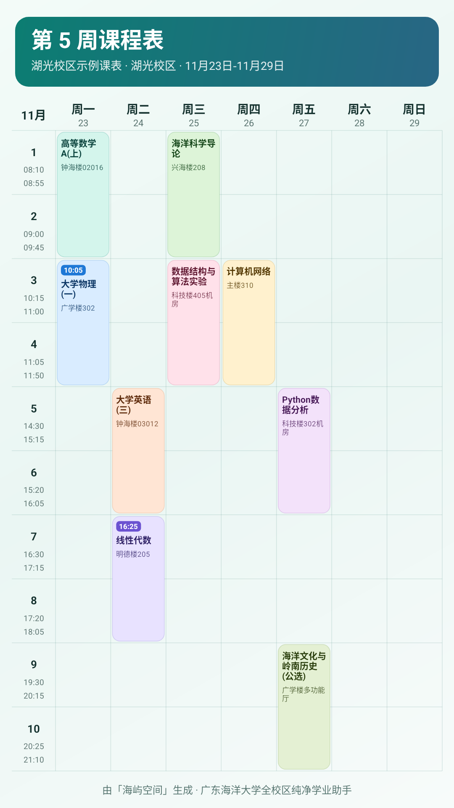

# 🌊 海屿空间（原名海屿课表）· 广海全校区纯净开源学业与课表工具

[](https://github.com/rex25415/gdou-haiyu-schedule/releases/latest)
[](https://github.com/rex25415/gdou-haiyu-schedule/actions/workflows/android-ci.yml)
[-3DDC84?logo=android&logoColor=white)](https://rex25415.github.io/gdou-haiyu-schedule/)
[](LICENSE)

> **非校方官方 & 非商业开源声明**：本项目由开源作者 [@rex25415](https://github.com/rex25415) 出于个人学习与技术交流开发的独立纯本地开源工具（内置广东海洋大学三校区公开作息模板），与任何高校官方无隶属或授权关系。应用 **零自建后端、零账号密码中转、零广告统计、零后台自动爬虫/选课/抢课**，采用 [PolyForm Noncommercial 1.0.0](LICENSE) 开源协议（禁止商用、禁止二次打包植入广告与冒充原作者分发）。详见 [安全与合规白皮书 (SECURITY.md)](SECURITY.md) 与 [NOTICE](NOTICE)。

专为 **广东海洋大学三校区（湖光主校区 · 海滨校区 · 阳江校区）** 适配的纯原生 **Kotlin + Jetpack Compose + Material 3** 安卓课表与学业空间（集成课表、免校园网同步、成绩/GPA 走势与目标反推、万能校园倒计时、DDL 任务清单、双人离线空课对比与四款桌面小组件）。

---

## 📥 极速下载安装（推荐发同学用中文下载主页）

- 🌐 **中文一键下载主页（推荐 · 内置国内多线加速与微信/QQ 跳转指引）**：https://rex25415.github.io/gdou-haiyu-schedule/
- 📦 **GitHub Releases 发布页**：https://github.com/rex25415/gdou-haiyu-schedule/releases/latest

- **支持系统**：Android 8.0 ～ Android 17（`minSdk 26` / `targetSdk 36` Android 16），同时兼容 **华为鸿蒙 4.x 及以下**（包体仅约 **1.92 MB**）；
- **更新节奏**：目前基础功能与兼容性已趋于稳定，正式版已转为 **每周 1～2 次的稳健迭代节奏**（不再频繁弹窗打扰；如遇教务改版或紧急故障将及时加急修复）。想抢先尝鲜新功能可在 App「设置 → 应用更新」开启 **Beta 预览通道**；
- **内置一键更新与验真**：内置 4 层免梯更新检查、国内多线加速下载与 **SHA-256 强制校验**，并配备 **运行时签名指纹验真**，防第三方篡改套壳；
- **包名说明（`v2.8.0+`）**：自 `v2.8.0` 起已全面启用中性个人开源包名 `io.github.rex25415.haiyu.schedule`（如此前装过 `v2.7.0` 及以下旧包名版本，可在旧版复制「同班课表分享码」1 秒导入新版后再卸载旧图标，之后所有升级均可直接无缝覆盖）。

---

## ✨ 界面预览

| 湖光主校区 · 清爽日间 | 深海蔚蓝 · 护眼深色 | 一键生成 7 天高清相册海报 |
| :---: | :---: | :---: |
|  |  |  |

---

## 🚀 核心功能一览

### 1. 免校园网一键同步广海正方教务（智能双通道 · 纯只读）
- **校外免校园网**：通过学校官方校外访问门户，4G/5G 流量与校外 Wi-Fi 均可直连登录，无需额外开 VPN；
- **校园网直连**：连接校园 Wi-Fi 时自动探测并支持一键切换直连，全链路强制 HTTPS 升级；
- 自动适配多因子二次认证页面（防白屏、防重定向死循环）；
- 一键离线读取：**个人课表 + 校历开学日期与总周数 + 全部历史成绩与加权 GPA + 等级考试档案 + 考试时间/考场/座位号 + 整周实践课**；
- 课表页右上角支持 **一键静默刷新课表**（同步临时调课并保留个人手动加课/调课），教务页升级 **「教务登录与同步 / 查空教室」双模式**，支持湖光/海滨/阳江三校区实时空教室查询、单间教室全天 5 大节逐节空课时间轴以及常去楼栋/教室收藏置顶。

### 2. 广海三校区自动识别 & 精准错峰作息
同步课表时自动读取校区与教学楼特征，匹配对应作息与错峰时间表（支持扩展 11–12 节晚课）：
- **湖光主校区**：常规 3–4 节 `10:15-11:50`、7–8 节 `16:30-18:05`；自动识别 `广学楼` / `明德楼` 错峰（3–4 节 `10:05-11:35`、7–8 节 `16:25-17:50`）；
- **海滨校区**：常规同上；自动识别 `实验楼`、`实+房号` 简写（如 `实506-1`）、球场及方位场地错峰（3–4 节 `10:05-11:35`、7–8 节 `16:25-17:50`）；
- **阳江校区**：常规 7–8 节 `16:20-17:55`、`慎思楼` 3–4 节 `10:25-12:00`，自动识别非慎思楼 3–4 节错峰 `10:10-11:40`。

### 3. 旗舰级课表体验 & 百宝箱收纳 / 期末投影 / 空课对比
- **清爽 7 天周视图 + 微缩单行预告条 + 行高自由切**：每周固定显示周一至周日，午休/晚课分隔标识清晰不截断；顶部「下一节动态预告条」可一键收起为微缩单行，搭配 **紧凑一屏 / 标准舒适 / 宽松大字** 三档行高与横屏/折叠屏紧凑顶栏；
- **「课表百宝箱」2×4 视觉工具抽屉**：首页一键直达查空教室、课程检索、双人空课对比、三校区作息表、手动加课、导出长图、假期调休、同班分享与整周实践课；
- **期末考试周自动投影 + 考前 1 小时提醒**：教务同步或手动添加的考试自动投影进对应教学周课表（周视图与日视图同步支持）、周次选择器暖色标注考试场数，点击横幅可展开本周考试总览；
- **课程详情考核标签 & 考勤/加分计次**：点开课程即可一键记下「开卷/闭卷/点名/期末占比」等考核备忘，并内置「请假/缺勤」与「发言/加分」计数器（教务重同步自动保留个人记录）；
- **纯离线「双人/室友空课交集」对比 + 零权限自定义壁纸 + 单周临时调课 / 节假日一键调休**。

### 4. 学业中心、三大设置工作台与桌面小组件
- **智能落地学业中心 & 学业深度分析抽屉**：根据待办/成绩/考务智能默认落页；内置作业 DDL 清单、支持可视化日历与临近截止提醒，并将多学期 GPA 走势折线图、补考/重修自动去重与多口径切换（有效去重 / 仅已通过 / 原始全计）、毕业学分目标分类审计、等级考试档案、目标 GPA 反推规划器整合进独立分析抽屉；深海/日间双模式均保持高对比度清晰呈现；
- **万能校园倒计时与图钉置顶**：支持四六级/考研/教资/竞赛/放假等预设快捷创建与手动置顶，置顶条目同步优先展示于桌面小组件；
- **设置与三大工作台架构**：高频学期/校历/作息/提醒控制前置，其余功能清晰收拢为 **外观与课表显示工作台 / 桌面小组件与备份工作台 / 更新验真与开源隐私中心**，支持设置内一键将小组件固定到桌面、兼容 Android 8–17 与 HEIC 的零权限壁纸导入，配合实时签名指纹校验与零隐私诊断导出；
- **四款桌面小组件（浅/深色自适应 + Android 12+ 桌面预览 + 零耗电跨日自动刷新）**：「海屿极简方卡（2×2）」+「海屿迷你下节课程（4×1）」+「海屿今日课表（4×2）」+「海屿考试与 DDL 倒计时（4×2）」。

---

## 🔒 隐私与安全承诺

1. **100% 纯本地运行**：无任何自建后端服务器、无广告 SDK、无统计上报；
2. **账号零留存**：教务登录完全在系统原生 WebView 内严格 HTTPS 直连 `*.gdou.edu.cn`，应用代码不接触、不存储、不上传任何学号与密码；
3. **关闭系统云备份 + 签名验真**：显式配置 `android:allowBackup="false"`，设置页内置运行时安装包签名指纹验真与一键清除登录缓存。

---

## 🛠️ 本地从源码编译

### 环境要求
- JDK 17
- Android SDK（Platform 36 / Build-Tools 36.0.0）
- Android Studio Meerkat+ 或直接使用仓库自带的 Gradle Wrapper

### 命令行构建
```bash
# 运行全部单元测试
./gradlew testDebugUnitTest

# 编译 Debug 安装包
./gradlew assembleDebug

# 编译 Release 安装包（如需自定义签名，参考 keystore.properties.example 创建 keystore.properties）
./gradlew assembleRelease
```

---

## 📄 开源非商用许可协议

本项目源码基于 [PolyForm Noncommercial License 1.0.0](LICENSE) 开源发布，请同时遵守 [NOTICE](NOTICE) 中的来源与非商用声明：
- ✅ 允许个人学习、免费自用、代码安全审计及非商业公益交流；
- ❌ 严禁任何商业用途、收费分发、二次打包植入广告或冒充原作者发布。
