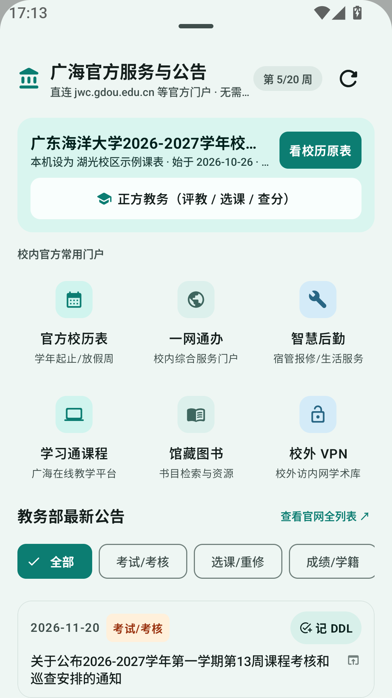

# 🌊 海屿空间（原名海屿课表）· 广海全校区纯净开源学业与课表工具

[](https://github.com/rex25415/gdou-haiyu-schedule/releases/latest)
[](https://github.com/rex25415/gdou-haiyu-schedule/actions/workflows/android-ci.yml)
[-3DDC84?logo=android&logoColor=white)](https://rex25415.github.io/gdou-haiyu-schedule/)
[](LICENSE)

专为 **广东海洋大学三校区（湖光主校区 · 海滨校区 · 阳江校区）** 适配的纯原生 **Kotlin + Jetpack Compose + Material 3** 安卓课表与学业空间（免校园网教务同步、分楼精准错峰、官网公告校历直达、成绩 GPA 去重与反推、空教室自习查询及四款桌面小组件）。

- 🌐 **中文高速下载主页（推荐 · 手机浏览器/QQ 直达，微信请复制进浏览器）**：https://rex25415.github.io/gdou-haiyu-schedule/
- 📦 **GitHub Releases 发布页**：https://github.com/rex25415/gdou-haiyu-schedule/releases/latest

> **非校方官方 & 非商业开源声明**：本项目由个人开发者 [@rex25415](https://github.com/rex25415) 基于兴趣开源维护（内置广海三校区公开作息模板），与任何高校官方无隶属关系。应用 **零自建后端、零账号密码中转、零广告统计、零后台自动爬虫/选课/抢课**，采用 [PolyForm Noncommercial 1.0.0](LICENSE) 开源协议（禁止商用与冒充重打包）。详见 [安全与合规白皮书 (SECURITY.md)](SECURITY.md) 与 [NOTICE](NOTICE)。

---

## 📥 版本、兼容性与更新节奏

- **支持系统**：Android 8.0 ～ Android 17（`minSdk 26` / `targetSdk 36`），同时兼容 **华为鸿蒙 4.x 及以下**（包体仅约 **2.00 MB**）；
- **更新节奏**：上线初期集中补齐核心刚需功能与修复紧急 Bug，因此前期连发了较多版本；目前核心已趋于稳定，正式版已转为 **每周 1～2 次的稳健迭代节奏**（日常不频繁弹窗打扰；如遇教务改版或紧急故障将随时加急修复）。想抢先尝鲜新功能可在 App「设置 → 应用更新」开启 **Beta 预览通道**；
- **内置一键更新与验真**：内置 4 层免梯更新检查、国内多线加速下载与 **SHA-256 强制校验**，并配备 **运行时签名指纹验真**，防第三方篡改套壳；
- **包名说明（`v2.8.0+`）**：自 `v2.8.0` 起已全面启用中性个人开源包名 `io.github.rex25415.haiyu.schedule`（如此前装过 `v2.7.0` 及以下旧包名版本，可在旧版复制「同班课表分享码」1 秒导入新版后再卸载旧图标，之后所有升级均可直接无缝覆盖）。

---

## ✨ 界面预览

| 清爽日间课表 | 护眼深色模式 | 广海官方服务与公告 | 7 天高清课表海报 |
| :---: | :---: | :---: | :---: |
|  |  |  |  |

---

## 🚀 核心功能一览

### 1. 纯原生零 WebView 引擎一键同步广海教务（纯本地 · 只读）
- **纯 Kotlin 原生 HTTPS 并发引擎（0 常驻 WebView）**：认证仅在按需弹出的广海官方页面完成（拦截 3.7MB 无用装饰大图、拿到票据立即销毁网页释放内存），随后课表、校历、成绩、考试与空教室 100% 走原生 HTTPS 并发拉取，彻底告别内嵌网页加载慢、掉帧卡顿与过期误报；
- **智能双通道 & 跨网无感续期**：4G/5G 蜂窝流量 0ms 秒判校外免校园网（WebVPN / 备用 wfw），校内 Wi-Fi 自动探测直连，支持 `CASTGC → WebVPN` 静默换票与 HTTP Keep-Alive 连接复用，全链路强制 HTTPS 并兼容企业微信扫码与二次验证；
- **刷新课表自动检查调课 & 查空教室 2.0**：首页右上角与教务中心均支持 1 秒静默刷课表，自动比对本地课表精准播报是否发生调课/换教室变动（保留手动调课/笔记）；内置三校区空闲教室与单室全天 5 大节时间轴查询，登录后自动回跳；
- **唯一清爽的官网直连入口**：教务中心提供按需全屏「访问广海正方教务官网」直连入口，方便办理教学评价、自主选课与培养方案查询，关闭即自动释放内存。

### 2. 广海官方服务站 & 三校区精准错峰
- **官方公告与校历直达**：免校园网拉取 `jwc.gdou.edu.cn` 最新考核/选课/成绩公告与官方学年校历原图，支持分类筛选与公告 **1 键转为作业 DDL 提醒**，集成一网通办、智慧后勤、学习通、馆藏图书、WebVPN 门户；
- **三校区自动识别错峰**：自动匹配湖光、海滨、阳江各教学楼与实验/球场错峰规则（支持 11–12 节晚课）。

<details>
<summary>📋 查看广海三校区详细错峰规则</summary>

- **湖光主校区**：常规 3–4 节 `10:15-11:50`、7–8 节 `16:30-18:05`；自动识别 `广学楼` / `明德楼` 错峰（3–4 节 `10:05-11:35`、7–8 节 `16:25-17:50`）；
- **海滨校区**：常规同上；自动识别 `实验楼`、`实+房号` 简写（如 `实506-1`）、球场及方位场地错峰（3–4 节 `10:05-11:35`、7–8 节 `16:25-17:50`）；
- **阳江校区**：常规 7–8 节 `16:20-17:55`、`慎思楼` 3–4 节 `10:25-12:00`，自动识别非慎思楼 3–4 节错峰 `10:10-11:40`。

</details>

### 3. 旗舰级课表体验、学业中心与四款桌面小组件
- **清爽周/日视图 & 课表百宝箱**：支持微缩单行预告条、三档行高自适应、考试周暖色投影与考前提醒、双人离线空课交集对比、单周临时调课 / 节假日调休、课堂考核备注与考勤计次；
- **学业中心 & 全景分析抽屉**：集成 DDL 任务清单、多学期 GPA 走势折线图、补考重修自动去重与口径切换、毕业学分分类审计、目标 GPA 反推规划及考试/放假万能倒计时置顶；
- **三大设置工作台 & 四款桌面小组件**：提供「海屿极简方卡（2×2）」「海屿迷你下节（4×1）」「海屿今日课表（4×2）」「海屿考试与 DDL（4×2）」，设置页一键放到桌面并支持零权限自定义课表壁纸（兼容 Android 8–17 与 HEIC）。

---

## 🔒 隐私与安全承诺

1. **100% 纯本地运行**：无自建后端服务器、无广告 SDK、无统计上报；
2. **账号零留存**：教务登录完全在系统原生 WebView 内严格 HTTPS 直连 `*.gdou.edu.cn`，应用不读取、不存储、不上传任何学号与密码；
3. **关闭云备份 + 签名验真**：显式禁用 `allowBackup`，设置页支持运行时签名证书验真与一键清除登录缓存。

---

<details>
<summary>🛠️ 本地从源码编译指南（JDK 17 + Android SDK 36）</summary>

```bash
# 运行全部单元测试
./gradlew testDebugUnitTest

# 编译 Debug 安装包
./gradlew assembleDebug

# 编译 Release 安装包（如需自定义正式签名，
# 可参考 keystore.properties.example 创建 keystore.properties）
./gradlew assembleRelease
```

</details>

---

## 📄 开源非商用许可协议

本项目源码基于 [PolyForm Noncommercial License 1.0.0](LICENSE) 开源发布，请同时遵守 [NOTICE](NOTICE) 中的来源与非商用声明：
- ✅ 允许个人学习、免费自用、代码安全审计及非商业公益交流；
- ❌ 严禁任何商业用途、收费分发、二次打包植入广告或冒充原作者发布。
