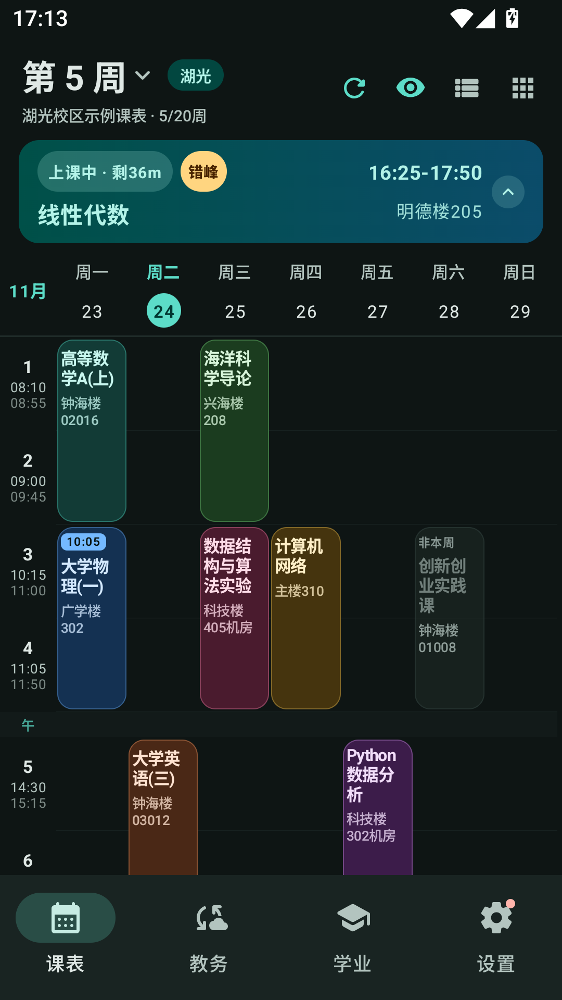

# 🌊 海屿课表 · 广东海洋大学全校区纯净开源课表 App

[](https://github.com/rex25415/gdou-haiyu-schedule/releases/latest)
[](https://github.com/rex25415/gdou-haiyu-schedule/actions/workflows/android-ci.yml)
[-3DDC84?logo=android&logoColor=white)](https://rex25415.github.io/gdou-haiyu-schedule/)
[](LICENSE)

> **非官方开源声明**：本项目为学生基于个人学习与开源交流开发的独立工具，与广东海洋大学官方无任何隶属关系。应用 **零自建后端、零账号密码中转、零广告统计、零后台自动爬虫/抢课**，所有数据 100% 仅保存在用户手机本地。详见 [安全与合规说明 (SECURITY.md)](SECURITY.md)。

专为 **广东海洋大学全校区（湖光主校区 · 海滨校区 · 阳江校区）** 打造的纯原生 **Kotlin + Jetpack Compose + Material 3** 安卓课表与学业助手。

---

## 📥 极速下载安装（推荐发同学用中文下载主页）

- 🌐 **中文一键下载主页（推荐 · 含国内多线加速与微信/QQ 跳转指引）**：https://rex25415.github.io/gdou-haiyu-schedule/
- 📦 **GitHub Releases 官方发布页**：https://github.com/rex25415/gdou-haiyu-schedule/releases/latest

- **支持系统**：Android 8.0 ～ Android 17（`minSdk 26` / `targetSdk 36` Android 16），同时完全兼容 **华为鸿蒙 4.x 及以下**（包体仅约 **1.6 MB**）；
- **内置一键更新**：`v2.5.0+` 内置自动检查更新，支持国内多线加速下载与 **SHA-256 完整性安全校验**，统一正式签名打包，覆盖升级自动保留全部课表、作业与设置。

---

## ✨ 界面预览

| 湖光主校区 · 清爽日间 | 深海蔚蓝 · 护眼深色 | 一键生成 7 天高清相册海报 |
| :---: | :---: | :---: |
|  |  |  |

---

## 🚀 核心功能一览

### 1. 免校园网一键同步广海正方教务（双通道）
- **校外通用(免校园网)**：通过学校官方校外访问门户，4G/5G 流量与校外 Wi-Fi 均可直连登录，无需额外开 VPN；
- **校园网直连**：连接校园 Wi-Fi 时随时可切换直连；
- 自动适配广海多因子二次认证页面（防白屏、防重定向死循环）；
- 一键离线抓取：**个人课表 + 校历开学日期与总周数 + 全部历史成绩与加权 GPA + 考试时间/考场/座位号**；
- 课表页右上角支持 **一键静默刷新课表**（随时同步学校临时调课，且自动保留个人手动加课/调课）；
- 教务快捷入口支持 **一键查空教室（自习推荐）**。

### 2. 广东海洋大学三校区自动识别 & 精准错峰作息
同步课表时自动读取校区与教学楼特征，匹配对应作息与错峰时间表（支持扩展 11–12 节晚课）：
- **湖光主校区**：自动识别 `广学楼` / `明德楼` 错峰（3-4 节 `10:05-11:35`、7-8 节 `16:25-17:50`）；
- **海滨校区**：自动识别 `实验楼`、`实+房号` 简写（如 `实506-1`）、球场及方位场地错峰（3-4 节 `10:05-11:35`、7-8 节 `16:25-17:50`）；
- **阳江校区**：内置阳江校区常规（`慎思楼` 3-4 节 `10:25-12:00`）与非慎思楼错峰（3-4 节 `10:10-11:40`、7-8 节 `16:20-17:55`）。

### 3. 旗舰级课表体验 & 重课/调课全适配
- **稳定 7 天周视图**：每一周页面固定显示周一到周日，绝不因周末没课而消失，支持左右滑屏翻周与课量热力周次选择器；
- **日历级视觉节奏**：现代无边框粉彩卡片、今日列高亮、午/晚轻分隔带、左侧当前节次高亮与无遮挡背景时间提示、周/日视图自由切换；
- **重课（时段冲突）全链路适配**：
  - 手机窄屏自动堆叠显示 + 醒目 `重×N` 徽标，点击弹出重课选择器查看全部冲突课程；
  - 平板/折叠屏大屏自动并排分列显示；日视图与高清海报图同步标出冲突；
- **单周临时调课（「仅调第 X 周」）**：老师班群临时通知本周调课/换教室时，一键仅改当周，不影响其他周次；同时支持 **节假日一键调休**。

### 4. 专为大学生打磨的学业与实用工具箱
- **作业 / 实验 DDL 清单**：点课表任意课程即可快速记作业 DDL，临近截止前在课表顶部贴心提醒；
- **成绩查询 & GPA 模拟器**：按学期筛选、关键词搜索、支持手动加模拟课测算目标绩点；
- **考试倒计时**：自动排序最近考试、清晰显示倒计时天数、考场与座位号；
- **一键生成 1080×1920 高清课表长图**：自动直存手机相册（`Pictures/海屿课表`），设锁屏壁纸或发室友超清晰；
- **同班课表分享码**：离线 JSON 分享码一键复制/导入，不含任何账号隐私；
- **安卓桌面小组件（「海屿今日课表」）+ 课前精准提醒 + `.ics` 系统日历导出**；
- **3 套海洋主题配色**（海屿薄荷青 / 深海蔚蓝 / 霞海日落）+ **深浅色模式** + **1.35x 超大字体与平板/折叠屏自适应** + **多品牌手机防杀后台指南**。

---

## 🔒 隐私与安全承诺

1. **100% 纯本地运行**：本应用无任何自建后端服务器、无广告 SDK、无数据上报统计；
2. **账号零留存**：教务登录完全在系统原生 WebView 内直接访问学校官方域名（`gdou.edu.cn`），应用代码不收集、不存储、不上传任何学号与密码；
3. **关闭系统云备份**：`AndroidManifest.xml` 显式配置 `android:allowBackup="false"`，且设置页随时支持一键彻底退出教务并清除 Cookie 缓存。

---

## 🛠️ 本地从源码编译

### 环境要求
- JDK 17
- Android SDK（Platform 36 / Build-Tools 36.0.0）
- Android Studio Meerkat+ 或直接使用仓库自带的 Gradle Wrapper

### 命令行构建
```bash
# 运行全部单元测试
./gradlew testDebugUnitTest

# 编译 Debug 安装包
./gradlew assembleDebug

# 编译 Release 安装包（如需正式签名，先参考 keystore.properties.example 创建 keystore.properties）
./gradlew assembleRelease
```

---

## 📄 开源协议

本项目基于 [MIT License](LICENSE) 完全开源，欢迎广东海洋大学各校区同学提 Issue、点 Star 或提交 PR 一起共建更好的广海工具！
