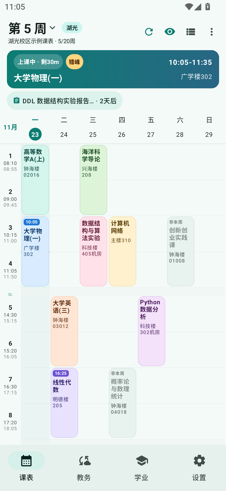

# 🌊 海屿课表 · 广海全校区纯净开源课表客户端

[](https://github.com/rex25415/gdou-haiyu-schedule/releases/latest)
[](https://github.com/rex25415/gdou-haiyu-schedule/actions/workflows/android-ci.yml)
[-3DDC84?logo=android&logoColor=white)](https://rex25415.github.io/gdou-haiyu-schedule/)
[](LICENSE)

> **非校方官方 & 非商业开源声明**：本项目是由学生出于个人学习与开源技术交流开发的独立纯本地正方教务课表客户端（内置广东海洋大学三校区公开作息模板），与任何高校官方无隶属或授权关系。应用 **零自建后端、零账号密码中转、零广告统计、零后台自动爬虫/选课/抢课**，采用 [PolyForm Noncommercial 1.0.0](LICENSE) 开源协议（禁止商用、禁止二次打包植入广告与冒充原作者分发）。详见 [安全与合规白皮书 (SECURITY.md)](SECURITY.md) 与 [NOTICE](NOTICE)。

专为 **广东海洋大学三校区（湖光主校区 · 海滨校区 · 阳江校区）** 适配的纯原生 **Kotlin + Jetpack Compose + Material 3** 安卓课表与学业助手。

---

## 📥 极速下载安装（推荐发同学用中文下载主页）

- 🌐 **中文一键下载主页（推荐 · 内置国内多线加速与微信/QQ 跳转指引）**：https://rex25415.github.io/gdou-haiyu-schedule/
- 📦 **GitHub Releases 发布页**：https://github.com/rex25415/gdou-haiyu-schedule/releases/latest

- **支持系统**：Android 8.0 ～ Android 17（`minSdk 26` / `targetSdk 36` Android 16），同时兼容 **华为鸿蒙 4.x 及以下**（包体仅约 **1.7 MB**）；
- **内置一键更新与验真**：内置 4 层免梯更新检查、国内多线加速下载与 **SHA-256 强制校验**，并配备 **运行时签名指纹验真**，防第三方篡改套壳；
- **包名说明（`v2.8.0+`）**：自 `v2.8.0` 起已全面启用中性个人开源包名 `io.github.rex25415.haiyu.schedule`（如此前装过 `v2.7.0` 及以下旧包名版本，可在旧版复制「同班课表分享码」1 秒导入新版后再卸载旧图标，之后所有升级均可直接无缝覆盖）。

---

## ✨ 界面预览

| 湖光主校区 · 清爽日间 | 深海蔚蓝 · 护眼深色 | 一键生成 7 天高清相册海报 |
| :---: | :---: | :---: |
|  |  |  |

---

## 🚀 核心功能一览

### 1. 免校园网一键同步广海正方教务（智能双通道 · 纯只读）
- **校外免校园网**：通过学校官方校外访问门户，4G/5G 流量与校外 Wi-Fi 均可直连登录，无需额外开 VPN；
- **校园网直连**：连接校园 Wi-Fi 时自动探测并支持一键切换直连，全链路强制 HTTPS 升级；
- 自动适配多因子二次认证页面（防白屏、防重定向死循环）；
- 一键离线读取：**个人课表 + 校历开学日期与总周数 + 全部历史成绩与加权 GPA + 考试时间/考场/座位号**；
- 课表页右上角支持 **一键静默刷新课表**（同步临时调课并保留个人手动加课/调课），教务菜单内置 **一键查空教室（自习推荐）**。

### 2. 广海三校区自动识别 & 精准错峰作息
同步课表时自动读取校区与教学楼特征，匹配对应作息与错峰时间表（支持扩展 11–12 节晚课）：
- **湖光主校区**：常规 3–4 节 `10:15-11:50`、7–8 节 `16:30-18:05`；自动识别 `广学楼` / `明德楼` 错峰（3–4 节 `10:05-11:35`、7–8 节 `16:25-17:50`）；
- **海滨校区**：常规同上；自动识别 `实验楼`、`实+房号` 简写（如 `实506-1`）、球场及方位场地错峰（3–4 节 `10:05-11:35`、7–8 节 `16:25-17:50`）；
- **阳江校区**：常规 7–8 节 `16:20-17:55`、`慎思楼` 3–4 节 `10:25-12:00`，自动识别非慎思楼 3–4 节错峰 `10:10-11:40`。

### 3. 旗舰级课表体验 & 期末考试投影 / 空课对比 / 壁纸全适配
- **清爽 7 天周视图 + 行高密度自由切 + 明日早课预告**：每周固定显示周一至周日，支持 **紧凑一屏 / 标准舒适 / 宽松大字** 行高切换，晚间自动预告明日早课、寒暑假零误报；
- **期末考试周自动投影 + 考前 1 小时提醒**：教务同步或手动添加的考试自动以醒目琥珀卡片投影进对应教学周课表，再也不怕期末周忘考；
- **纯离线「双人/室友空课交集」对比**：粘贴室友或搭子的海屿分享码，零联网即刻算出本周两人都没课的时段并一键复制发微信；
- **零权限自定义课表壁纸 + 课程详情随手快记笔记**：支持调节卡片不透明度，点课程详情即可随手记录老师考勤与平时分要求；
- **重课（时段冲突）置顶显示 + 本学期课程聚合检索 + 单周临时调课 + 节假日一键调休**。

### 4. 学业中心、双桌面小组件与离线实用工具箱
- **作业 / 实验 DDL 清单**：支持可视化日历选截止日期、编辑修改、临近截止本地提醒，且在课表点击课程详情即可直接查看该课程关联待办；
- **成绩查询 & GPA 趋势折线图 + 学分分类统计**：内置纯原生各学期 GPA 走势图、必修/选修/实践已修学分分类统计与模拟算分器；
- **考试倒计时 + 一键复制纯文本清单**：自动排序最近考试、支持编辑与复制纯文本发微信/QQ；
- **双桌面小组件（浅/深色自适应）**：「海屿今日课表」+ 全新「海屿考试与 DDL 倒计时」；
- **全量本地换机备份与还原（JSON）+ 1080×1920 高清长图 + `.ics` 系统日历导出 + 零权限旧包名迁移清理引导**。

---

## 🔒 隐私与安全承诺

1. **100% 纯本地运行**：无任何自建后端服务器、无广告 SDK、无统计上报；
2. **账号零留存**：教务登录完全在系统原生 WebView 内严格 HTTPS 直连 `*.gdou.edu.cn`，应用代码不接触、不存储、不上传任何学号与密码；
3. **关闭系统云备份 + 签名验真**：显式配置 `android:allowBackup="false"`，设置页内置运行时安装包签名指纹验真与一键清除登录缓存。

---

## 🛠️ 本地从源码编译

### 环境要求
- JDK 17
- Android SDK（Platform 36 / Build-Tools 36.0.0）
- Android Studio Meerkat+ 或直接使用仓库自带的 Gradle Wrapper

### 命令行构建
```bash
# 运行全部单元测试
./gradlew testDebugUnitTest

# 编译 Debug 安装包
./gradlew assembleDebug

# 编译 Release 安装包（如需自定义签名，参考 keystore.properties.example 创建 keystore.properties）
./gradlew assembleRelease
```

---

## 📄 开源非商用许可协议

本项目源码基于 [PolyForm Noncommercial License 1.0.0](LICENSE) 开源发布，请同时遵守 [NOTICE](NOTICE) 中的来源与非商用声明：
- ✅ 允许个人学习、免费自用、代码安全审计及非商业公益交流；
- ❌ 严禁任何商业用途、收费分发、二次打包植入广告或冒充原作者发布。
